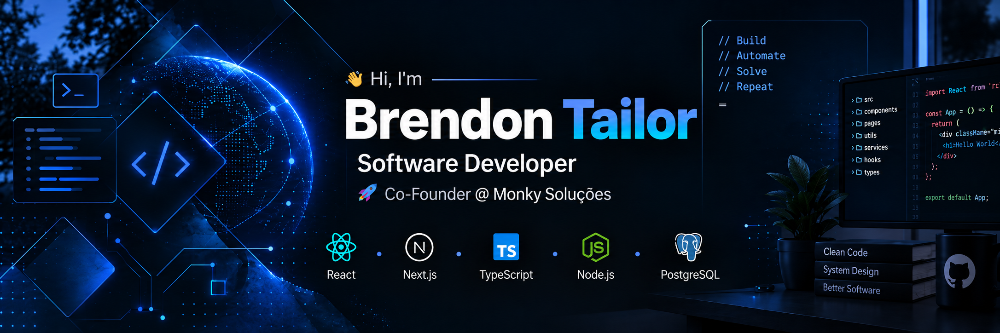

  

# Hi, I'm Brendon Tailor

Full-stack developer and co-founder of **Monky Soluções**. I build SaaS products, custom systems and web applications for real businesses.

I work across product, backend and frontend — from data modeling and APIs to interfaces that people use every day.

  
  

---

## What I do

- **SaaS products:** multi-tenant platforms with company isolation, roles and white-label operation.
- **Business systems:** POS, inventory, purchases, finance, reports and audit.
- **Full-stack web:** React, Next.js, Node.js, Express, PostgreSQL and Prisma.
- **Operational tools:** PWAs with maps, search, offline support and field workflows.
- **Product work:** from data modeling and API design to UI, deploy and iteration.

---

## Featured work

| Project | What it is | Links |
| --- | --- | --- |
| **Sah Açaí & Cia** | WhatsApp ordering and financial dashboard for a real food retailer. | [Case](https://github.com/Brendontailor/portfolio/blob/main/cases/sah-acai.md) |
| **Monky Food** | Multi-tenant SaaS for food-service stores, with Sah Açaí as the first operation. | [Case](https://github.com/Brendontailor/portfolio/blob/main/cases/monky-food.md) |
| **Monky Tech** | Management SaaS for electronics and phone-case stores: POS, stock, finance and audit. | [Case](https://github.com/Brendontailor/portfolio/blob/main/cases/monky-tech.md) |
| **RoutePilot** | Field-service mapping and route-planning PWA. | [Live](https://routpilotes.vercel.app) · [Case](https://github.com/Brendontailor/portfolio/blob/main/cases/routepilot.md) |
| **PortCont** | Smart comparison of client bases in PDF, Excel and CSV. | [Live](https://portcont.vercel.app) · [Case](https://github.com/Brendontailor/portfolio/blob/main/cases/portcont.md) |
| **Dropzone** | Streetwear e-commerce built in collaboration with Leonardo Rosler. | [Case](https://github.com/Brendontailor/portfolio/blob/main/cases/dropzone.md) |

More context, screenshots and technical details are in the **[portfolio repository](https://github.com/Brendontailor/portfolio)**.

---

## Currently building

- **Monky Food** — a multi-tenant SaaS for food service.
- **Monky Tech** — management software for electronics and phone-case retail.
- Better architecture, stronger TypeScript and products that solve real operational problems.

---

## Tech stack

---

## Contact

- GitHub: [@Brendontailor](https://github.com/Brendontailor)
- LinkedIn: [brendon-tailor](https://www.linkedin.com/in/brendon-tailor-404144284)
- Portfolio: [Brendontailor/portfolio](https://github.com/Brendontailor/portfolio)

  <b>Building products, learning every day and turning ideas into real systems.</b>

